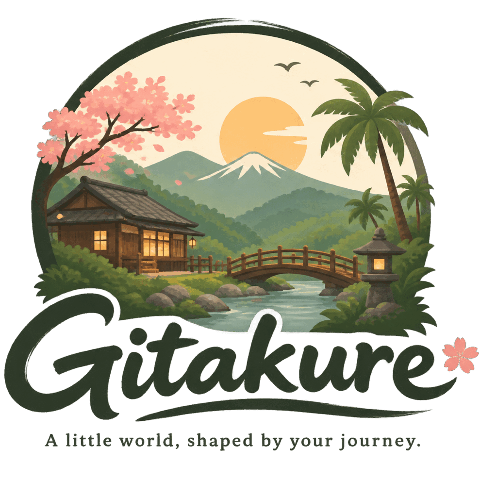

<p align="center">
  
</p>

# Gitakure

A peaceful low-poly 3D countryside that runs in the browser. Explore a village,
sit beside a river, watch the rain, visit a shrine, or spend time by a campfire.
The world blends Japanese and Kerala countryside influences into one cohesive,
fictional environment.

**Gitakure is not a game about getting more work done. It is a place where you can forget about work for a while.**

---

## Quick start

Requires [Bun](https://bun.sh) 1.4+.

```bash
bun install
bun run dev        # http://localhost:5173
```

Production build:

```bash
bun run build
bun run preview    # http://localhost:4173
```

Other commands:

```bash
bun run typecheck  # vue-tsc --noEmit
bun run test       # vitest
```

---

## Stack

| Layer | Technology |
|---|---|
| Runtime | Bun |
| Language | TypeScript |
| Build | Vite |
| UI | Vue 3 (Composition API) |
| State | Pinia |
| 3D engine | Three.js (WebGL) |
| Persistence | Dexie.js (IndexedDB) |
| Testing | Vitest |

No backend, no React/Next, no Phaser, no Blender, no external CDNs.

---

## Controls

| Input | Action |
|---|---|
| `WASD` / arrows | Move |
| `Shift` | Run |
| `E` | Interact (sit by campfire / bench, talk to NPCs) |
| `Tab` / `I` | Open 10-slot Inventory |
| `M` | Open illustrated World Map |
| `V` | Toggle first-person / third-person camera |
| `Esc` | Close modal / Open Settings menu |
| `Shift+Space` | Pause |

---

## Architecture

```
src/
  app/            Vue entry (main.ts, App.vue, workshop.ts)
  components/     MainMenu, GameplayHUD, InventoryModal, WorldMapModal, DialogueBox, SettingsModal, GithubModal, Workshop (dev)
  game/
    core/         Game, GameLoop, GameBridge, GameConfig
    rendering/    Renderer, SceneManager, CameraController, Lighting
    world/        TerrainSystem, WaterSystem, VegetationSystem, VillageGenerator, WorldManager
    entities/     Player, CharacterFactory, NPC, Cat, Campfire
    systems/      Movement, Interaction, Time, Weather, Season, Audio, GitHubWorld
    procedural/   materials, geometry helpers, vegetation/buildings/props generators
    assets/       AssetManager (GLTFLoader), AssetRegistry
    tools/        AssetWorkshop (dev-only)
  stores/         settingsStore, githubStore
  database/       Dexie schema + repositories
  services/github/  GitHub data fetch
  github/interpreter/  history → milestones → keepsakes
  types/  utils/  styles/
```

Three.js owns the world and rendering. Vue owns menus/HUD/settings. Pinia
coordinates app state. Dexie persists player/world/settings/memories. The
typed `GameBridge` connects them — **no Three.js objects in Pinia**.

---

## Dynamic Game Interface & Asset System

All visual elements, character models, and interface screens are built programmatically in code (Three.js WebGL + Vue 3):

- **Main Menu & Cinematic Vista:** Live Three.js engine boots immediately in menu mode with procedural calico companion cat (`Cat.ts`), glowing stone lantern, arched wooden bridge, and riverside bench.
- **Dynamic Character Models & Expressions:** Canvas-textured anime faces (`CharacterFactory.ts`), female and male archetypes with customizable hair styles, accessories (sakura flower clip, obi sash), and procedural animations (walk bob, idle breathing, sit).
- **Parchment Settings & Inventory HUD:** Styled after classic Japanese countryside journals with graphics quality pills, sound sliders, 5 inventory categories, SVG icons, and item actions.
- **Living NPCs & Dialogue System:** 5 unique villager archetypes (Elder Grandfather, Elder Grandmother, Village Boy, Maiden Mika, Farmer Devan) with interactive dialogue triggered via proximity `[E] Interact`.
- **Illustrated World Map:** SVG-rendered watercolor map displaying village locations, rice paddies, winding river, and real-time player position.
- **Atmospheric Golden-Hour Lighting:** Directional honey-amber sunlight with rose-lavender sky ambient and soil bounce light.

---

## Assets

The Quaternius stylized nature packs (80 GLB files) live in `glb/` and are
served from `/glb/`. See `src/game/assets/AssetRegistry.ts` for the full
catalog (name, source pack, license CC0, biome, intended usage).

Procedural generators (TypeScript + Three.js) build coconut palms, bamboo,
sakura, pine, houses, torii, bridges, rocks, grass, flowers — see
`src/game/procedural/`.

---

## Asset workshop (dev-only)

A developer tool for previewing and exporting procedural assets. Not part of
the player build.

```bash
bun run dev
# open http://localhost:5173/workshop.html
```

Select a category, tweak parameters, regenerate, export as GLB.

---

## Deployment

Static hosting (GitHub Pages, Cloudflare Pages, Netlify). `vite.config.ts`
sets `base: './'` so production assets load from any subpath. No runtime
dependency on external CDNs.

---

## Credits

**Environment models by [Quaternius](https://quaternius.com/)** — released under
[CC0](https://creativecommons.org/publicdomain/zero/1.0/), so they are free to
use, modify and redistribute with no attribution required. Credited here as a
matter of course, not obligation.

The eighty GLB files in `glb/` come from two Quaternius packs:

| Pack | Used for |
|---|---|
| Ultimate Stylized Nature | Trees, bushes, rocks, plants, pebbles, stepping-stone paths, flowers, grass, mushrooms |
| Stylized Nature MegaKit | Additional trees, plants and environmental variety |

Files were used as downloaded; nothing was re-modelled. Per-asset source pack,
path and intended use are recorded in `src/game/assets/AssetRegistry.ts`.

Everything else — terrain, water shader, coconut palms, bamboo, sakura, pine,
Japanese and Kerala houses, torii, bridges, props, the player character, and all
audio — is generated at runtime from code in this repository. No other third-party
art or audio assets are included.

### Brand assets

The Gitakure logo is supplied artwork, used unmodified apart from trimming,
resizing and palette reduction. Sized variants live in `public/brand/`:

| File | Use |
|---|---|
| `logo-square.png` | Source, trimmed to a 1024×1024 square |
| `logo-512.png`, `logo-192.png` | PWA and manifest icons |
| `apple-touch-icon.png` | iOS home screen |
| `favicon.ico`, `favicon-32.png`, `favicon-16.png` | Browser tabs |
| `site.webmanifest` | Install metadata |

`docs/` carries its own smaller copies because it is published as a standalone
static folder with no build step.

### Built with

[Three.js](https://threejs.org/) · [Vue 3](https://vuejs.org/) ·
[Pinia](https://pinia.vuejs.org/) · [Dexie.js](https://dexie.org/) ·
[Vite](https://vite.dev/) · [Bun](https://bun.sh/) ·
[Vitest](https://vitest.dev/)

Typefaces: [Fraunces](https://fonts.google.com/specimen/Fraunces) and
[Karla](https://fonts.google.com/specimen/Karla), both under the SIL Open Font
License.

---

**Gitakure is not a game about getting more work done. It is a place where you can forget about work for a while.**